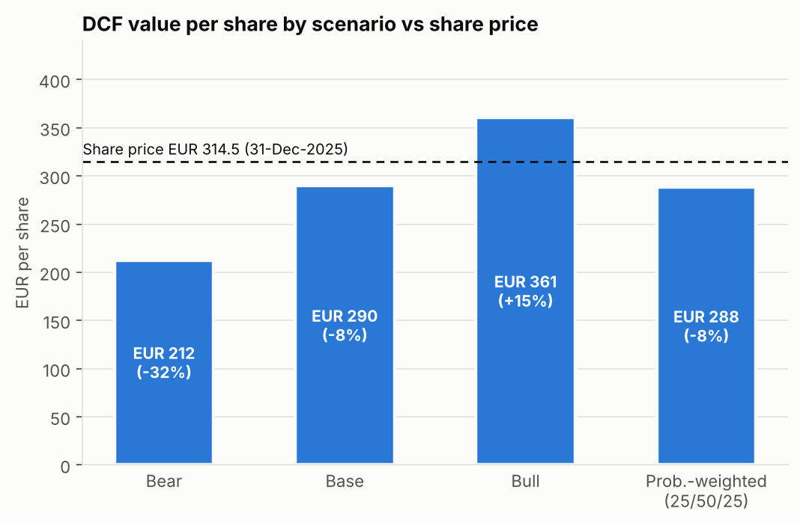
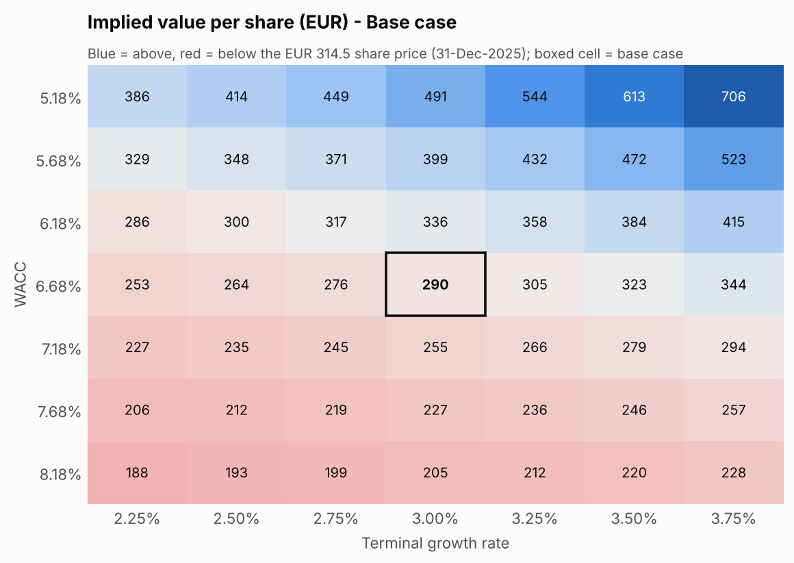
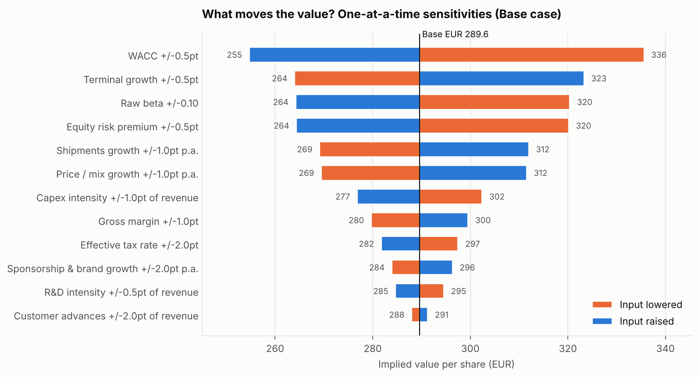
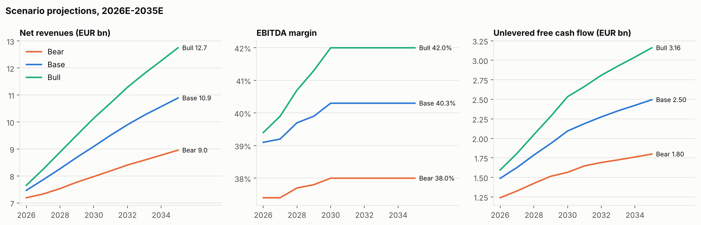

# Ferrari N.V. — Equity Valuation & Financial Modelling

An integrated **three-statement model and DCF valuation of Ferrari N.V. (NYSE / EXM: RACE)** in Excel. A Python
companion (pandas / NumPy) re-implements the model from the workbook's inputs, automates the sensitivity analysis and
reconciles every output back to the Excel model.

Valuation date **31-Dec-2025** (latest audited balance sheet), using reported FY2023–FY2025 financials and a
2026E–2035E forecast. All figures are in EUR m unless stated.

| | Bear | **Base** | Bull | Prob.-weighted (25/50/25) |
|---|---:|---:|---:|---:|
| Implied value per share | €212 | **€290** | €361 | €288 |
| vs share price of €314.52 (31-Dec-2025) | −32% | **−8%** | +15% | −8% |
| Enterprise value | €37.7bn | **€51.4bn** | €64.0bn | |
| 2030E net revenues | €8.0bn | **€9.1bn** | €10.1bn | |
| 2030E EBITDA margin | 38.0% | **40.3%** | 42.0% | |

WACC is **6.68%** (CAPM cost of equity 6.89%) and terminal growth is **3.0%**. The terminal value is 71% of EV, which
implies 15.9x 2035E EBITDA. At its year-end 2025 price the market is paying for something between the base and bull
cases: about 19x 2026E EBITDA and 33x 2026E earnings.



---

## What's in the project

| Component | Implementation |
|---|---|
| **Integrated three-statement model in Excel**, linking historical financials to forecasts for revenue, margins, working capital, capex and free cash flow | [`model/Ferrari_Valuation_Model.xlsx`](model/Ferrari_Valuation_Model.xlsx): `Historicals` → `Revenue Build` → `IS` / `BS` / `CF`. The balance sheet balances in every year and cash comes from the cash-flow statement. |
| **DCF with CAPM-derived cost of equity and WACC**; sensitivity across WACC and terminal growth | `WACC` sheet: Rf + Blume-adjusted β × ERP, after-tax Kd, market-value weights. `DCF`: unlevered FCF, mid-year discounting, Gordon-growth TV, bridge to equity. `Sensitivity`: 7×7 WACC × g grids. |
| **Base, bull and bear cases** for revenue growth, margins and reinvestment | `Assumptions` sheet: one selector cell drives Bear / Base / Bull tables for shipments, price/mix, sponsorship growth, gross margin and capex intensity |
| **Python (pandas, NumPy) to automate sensitivity analysis and reconcile outputs with the Excel model** | [`ferrari_valuation/`](ferrari_valuation/) package plus [`scripts/run_sensitivity.py`](scripts/run_sensitivity.py) and [`scripts/reconcile_with_excel.py`](scripts/reconcile_with_excel.py) |

```
├── model/Ferrari_Valuation_Model.xlsx     # the Excel model (1,573 live formulas)
├── data/ferrari_reported_financials.csv   # reported FY2023-FY2025 figures with sources
├── ferrari_valuation/                     # Python companion
│   ├── layout.py        # sheet names, year columns and row labels the Python code reads
│   ├── excel_io.py      # reads inputs (by row label) and calculated outputs from the workbook
│   ├── engine.py        # independent pandas/NumPy three-statement + WACC + DCF engine
│   ├── sensitivity.py   # scenarios, WACC x g, tornado, growth x margin grids
│   ├── reconcile.py     # line-by-line Excel vs Python comparison
│   ├── libreoffice.py   # headless recalculation (switch scenarios without Excel)
│   └── charts.py        # matplotlib charts
├── scripts/
│   ├── run_sensitivity.py        # automated sensitivity analysis -> outputs/
│   └── reconcile_with_excel.py   # Excel vs Python reconciliation -> outputs/
├── outputs/                      # CSVs, python_sensitivity_results.xlsx, charts/, reconciliation report
└── tests/test_model.py           # integrity + reconciliation tests (pytest)
```

## The Excel model

| Sheet | Contents |
|---|---|
| **Cover** | Live key outputs, model map with links, colour legend, methodology |
| **Assumptions** | Scenario selector (`1/2/3`), valuation inputs, Bear/Base/Bull driver tables (live row = `CHOOSE`), common operating & financing assumptions, with 2023A–2025A actuals alongside for reference |
| **Historicals** | As-reported income statement, revenue by type, shipments, statement of financial position, cash-flow totals and KPIs, each with its source |
| **Revenue Build** | Shipments × net revenue per car (price / mix / personalisation) + sponsorship, commercial & brand + other |
| **IS** | Revenue → gross profit → SG&A, R&D, other → EBIT → net financial expense (on opening balances, no circularity) → tax → net profit, EBITDA, EPS |
| **BS** | Working capital from days / % of revenue, fixed assets rolled forward (+capex −D&A), equity rolled forward (+NI −dividends −buybacks), balance check |
| **CF** | CFO / CFI / CFF. Dividends = payout × prior-year profit. Buybacks = target, capped by cash above a minimum balance. Ending cash → BS |
| **WACC** | Rf 2.86% (10Y Bund) + 0.73 adjusted β × 5.5% ERP = 6.89% Ke; Kd 3.5% pre-tax; 95/5 equity/debt at market values |
| **DCF** | UFCF = EBIT(1−t) + D&A − capex − ΔNWC; mid-year factors; TV = UFCF₂₀₃₅(1+g)/(WACC−g); EV − net industrial debt = equity |
| **Sensitivity** | Value per share, upside/downside and EV across WACC ± 1.5pt and g ± 0.75pt, all as closed-form formulas with no Data Tables, so the grids follow the scenario selector |
| **Checks** | 10 integrity checks (balance sheet, cash tie-out, revenue build, historical tie-outs, minimum cash, WACC > g, grid centre = DCF) |

Formatting follows banking conventions: **blue** inputs, **black** formulas, **green** cross-sheet links, yellow key
assumptions. Negatives are shown in parentheses.

### Base case anchors

The base case is calibrated to company guidance, not picked freehand:

| Anchor | Company | Model (base) |
|---|---|---|
| FY2026 revenue / EBITDA margin (Feb-2026 guidance) | ~€7.5bn / ≥39% | €7.47bn / 39.1% |
| 2030 revenue (Oct-2025 Capital Markets Day) | ~€9.0bn | €9.09bn |
| 2030 EBITDA / EBIT margin (CMD) | ≥€3.6bn, ≥40% / ≥30% | €3.66bn, 40.3% / 30.8% |
| Capex 2026–2030 (CMD) | ~€4.7bn | €4.74bn |
| Dividend payout (CMD) | 40% | 40% |
| Buyback 2026–2030 (CMD) | ~€3.5bn | €3.5bn |

`tests/test_model.py` asserts these anchors, so a change to the assumptions that breaks guidance fails the tests.

## Sensitivity analysis

| WACC × terminal growth (value per share, Base) | One-at-a-time drivers (Base) |
|---|---|
|  |  |

- **Discount rate dominates.** ±0.5pt of WACC moves the value from €255 to €336, which is more than any operating driver.
  Ferrari's low regression beta (0.60 raw, 0.73 adjusted) keeps WACC near 6.7%. With a beta of 1.0, WACC is
  8.1% and the base-case value falls to about €209/share.
- **Growth beats margin.** +1pt a year of price/mix growth adds about €22/share. +1pt of gross margin adds about €10.
  The full growth × margin grid is in `outputs/sensitivity_growth_margin_base.csv`.
- **Reinvestment matters.** Cutting capex intensity by 1pt of revenue adds about €13/share.



## Python: automation and reconciliation

```bash
pip install -r requirements.txt

python scripts/run_sensitivity.py                     # scenarios, WACC x g, tornado, growth x margin -> outputs/
python scripts/reconcile_with_excel.py                # reconcile against the values saved in the workbook
python scripts/reconcile_with_excel.py --all-scenarios  # recalc Bear/Base/Bull via LibreOffice, reconcile each
python -m pytest -q                                   # integrity, anchor and reconciliation tests
```

The engine reads only the workbook's **hard-coded inputs** (located by row label, not cell address) and recomputes the
revenue build, three statements, WACC, DCF and sensitivity grids independently. The reconciliation compares
**368 line items per scenario** (forecast IS/BS/CF lines, UFCF, discount factors, WACC, EV bridge and both 7×7 grids):

```
Bear   368 comparisons  max |diff| 5.09e-11  PASS
Base   368 comparisons  max |diff| 2.91e-10  PASS
Bull   368 comparisons  max |diff| 4.95e-10  PASS
```

See [`outputs/reconciliation_report.md`](outputs/reconciliation_report.md). Change an input in Excel, save, and re-run both
scripts; the sensitivity outputs update and the reconciliation confirms the two implementations still agree.
`--all-scenarios` needs LibreOffice (`soffice`) on the PATH; otherwise switch the scenario in Excel and save between runs.

## Data sources

- Ferrari N.V. Annual Report & Form 20-F FY2025 and FY2024: income statement, statement of financial position, cash-flow totals, share count (177,278,893 shares at 31-Dec-2025)
- Ferrari FY2025 / FY2024 / FY2023 results press releases: EBIT, net profit, revenue by type, shipments, industrial FCF, net industrial debt (€32m at 31-Dec-2025), FY2026 guidance
- Ferrari Capital Markets Day (9-Oct-2025): 2030 targets, capex plan, payout and buyback programme
- Market data at 31-Dec-2025: RACE NYSE close $369.56, ECB EUR/USD 1.1750, 10Y Bund 2.86%; Yahoo Finance 5Y monthly beta 0.60 (vs FTSE MIB)

Items marked *derived* in the `Historicals` sheet are balancing figures that reconcile reported totals: other
current assets, investments & other financial assets, 2025 employee benefits, other expenses, income tax and the
cash-flow reconciling lines. FY2025 share repurchases (~€784m) are built from the tranche disclosures.

## Key judgements & limitations

- **Financial services.** The Ferrari Financial Services loan book (~€1.6bn) and the debt that funds it are held flat
  and kept out of operating FCF. Equity value therefore deducts *net industrial debt*, as Ferrari reports it, rather than total net debt.
- **ERP of 5.5% and Blume-adjusted beta.** These are judgement calls; the tornado and the WACC grid show the range.
- **Single forecast tax rate** (23%, vs 22.5% in 2025 with the Patent Box benefit) for both NOPAT and net profit.
- **Condensed balance sheet.** PP&E and intangibles are combined. Provisions, deferred taxes and other financial liabilities are held flat.
- Historical figures are compiled from Ferrari's public filings and results releases; verify them against the
  primary documents before relying on them.

*Educational project; not investment advice.*
